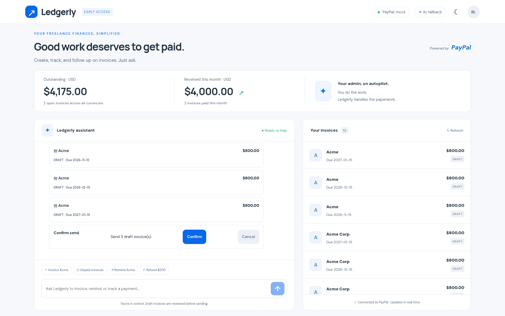
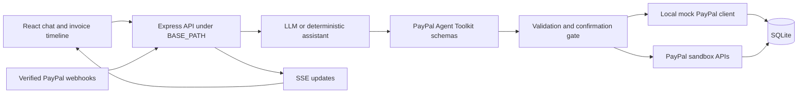
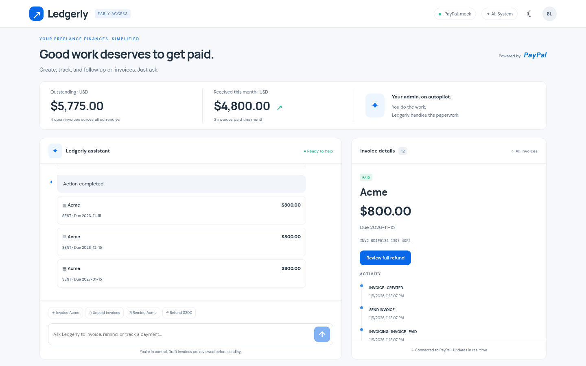
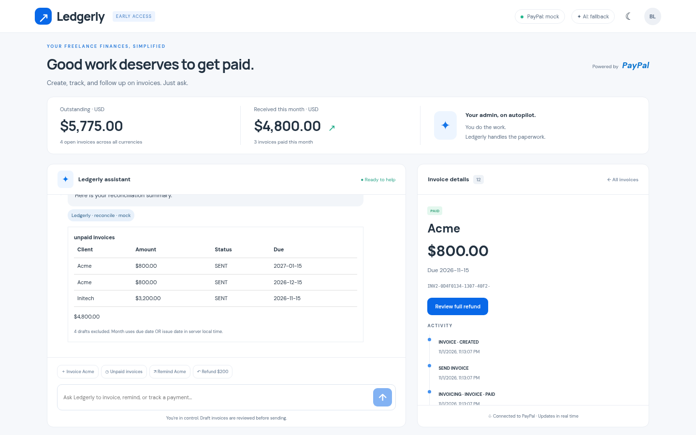
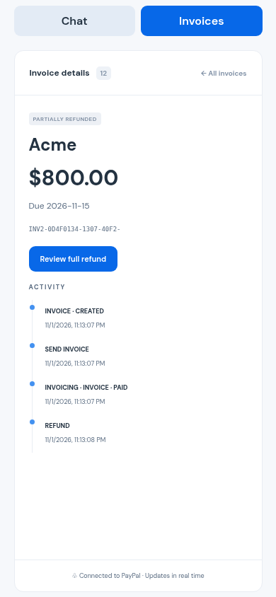

# Ledgerly

**Good work deserves to get paid.** Ledgerly is a conversational invoicing workspace for freelancers and small studios. Create a monthly invoice series, review before sending, track payments, reconcile outstanding balances, and follow up with a reminder in one place.



## How it works

Ledgerly uses PayPal Invoicing, Orders, Payments, and Refunds APIs through a shared client interface. The PayPal Agent Toolkit supplies the financial tool schemas shown to the assistant. Ledgerly validates tool arguments, resolves client references, and gates invoice sending and refunds behind explicit confirmation. Toolkit chips show the selected tool and executor; they do not imply that a mock operation contacted PayPal.

An optional OpenAI-compatible LLM endpoint interprets requests and calls tools. Without LLM configuration, a deterministic assistant supports the demo flows. Confirmation and cancellation replies use **System** mode regardless of LLM availability.



## Features

- Draft invoices and a three-month recurring series with confirm-before-send.
- Invoice detail, activity timeline, and live payment updates over SSE.
- Paid, unpaid, and overdue reconciliation with totals grouped by currency.
- Friendly, firm, and final reminder drafts; explicit send action.
- Confirmed partial refunds with remaining-balance validation.
- Responsive Chat/Invoices tabs, theme switch, loading and error states.
- Fully local mock mode and realistic sample data.





## Quickstart

Requires Node.js 20+ and npm. SQLite uses `better-sqlite3`; Python, make, and a C++ compiler may be needed if a native binary is unavailable.

```bash
npm ci
cp .env.example .env
npm run seed
npm run build
npm start
```

Open http://localhost:3000/. Default mode is mock: no money moves. Try the **Invoice Acme** suggestion, confirm the series, open a sent invoice, and click **Simulate paid**.

## Configuration

| Variable | Default / purpose |
| --- | --- |
| `PORT` | `3000` |
| `BASE_PATH` | `/`; use `/paypal-agent/` behind the demo proxy |
| `DB_PATH` | `./data/app.db` |
| `PAYPAL_MODE` | `mock`; `sandbox` enables real sandbox API requests |
| `PAYPAL_CLIENT_ID`, `PAYPAL_CLIENT_SECRET` | Sandbox app credentials |
| `PAYPAL_WEBHOOK_ID` | Webhook ID used for signature verification |
| `PAYPAL_ENV_FILE` | Optional credential file; defaults to `/home/box/.secrets/paypal_sandbox.env` |
| `PAYPAL_TOOLKIT_EXECUTION` | `ours` (validated client adapter); `toolkit` opts into toolkit execution in sandbox |
| `LLM_BASE_URL`, `LLM_API_KEY`, `LLM_MODEL` | All three enable an OpenAI-compatible chat completions endpoint |
| `SEED_ON_START` | `1` seeds an empty mock database; ignored in sandbox |
| `URL` | Browser-check target; default `http://localhost:3400/paypal-agent/` |
| `CHROMIUM_PATH` | Optional installed Chromium executable for offline browser checks |

Keep credentials in an untracked `.env`. Empty LLM values select fallback unless supplied by the optional credential file. For strictly local checks set `PAYPAL_ENV_FILE` to a nonexistent local path, `PAYPAL_MODE=mock`, and clear all three LLM values. Web fonts and external visual assets are not required.

## Scripts and verification

| Command | Purpose |
| --- | --- |
| `npm run dev` | Build frontend, watch server |
| `npm run build` | Type-check and build frontend and server |
| `npm start` | Run compiled server |
| `npm run seed` | Seed empty DB with nine mock invoices and six clients |
| `npm run reset` | Delete DB and WAL files; stop the server first |
| `npm run reset -- --seed` | Reset and seed |
| `npm run smoke` | API flow checks against a running mock server |
| `npm run ui-check` | Real UI flows and screenshots against an existing local server |

Install a browser with `npx playwright install chromium` (requires network; use `--with-deps` only if system libraries are missing). For offline environments use `CHROMIUM_PATH` with a preinstalled Chromium. The checked-in Playwright version matches the package available offline in the development environment.

```bash
# Build and start in one terminal; use a disposable database.
BASE_PATH=/paypal-agent/ npm run build
BASE_PATH=/paypal-agent/ PORT=3400 PAYPAL_MODE=mock \
  PAYPAL_ENV_FILE=/tmp/no-ledgerly-secrets LLM_BASE_URL= LLM_API_KEY= LLM_MODEL= \
  DB_PATH=/tmp/ledgerly-check.db SEED_ON_START=1 npm start
# In another terminal:
BASE_PATH=/paypal-agent/ PORT=3400 npm run smoke
npm run ui-check
```

The browser check starts no server, restricts requests to the target loopback origin, and writes desktop/mobile screenshots to `docs/screenshots/`. See [UI findings](docs/UI_CHECK.md).

## Mock and sandbox

Mock mode persists PayPal-shaped objects locally and simulates payment webhooks. Seed/reset tooling never contacts PayPal; seeding refuses sandbox mode internally. Sample clients use reserved `.example` email addresses. The three-month series creates separate drafts; it is not a scheduled subscription billing engine.

Sandbox mode sends requests to PayPal's sandbox and verifies webhook signatures using the configured webhook ID. Use sandbox buyer accounts and controlled recipient addresses. A capture refund requires a stored capture relationship; recording an invoice refund is a different operation from moving captured funds. Never use mock payment actions to demonstrate a real transfer.

## Deployment

[Deployment guide](docs/DEPLOY.md) covers the prepared systemd unit, prefix-preserving nginx snippet, public webhook route, and explicitly gated upload script. Deployment is a separate operator action.

[Devpost submission](docs/DEVPOST.md) · [Demo video script](docs/VIDEO_SCRIPT.md)

## License

[MIT](LICENSE).
